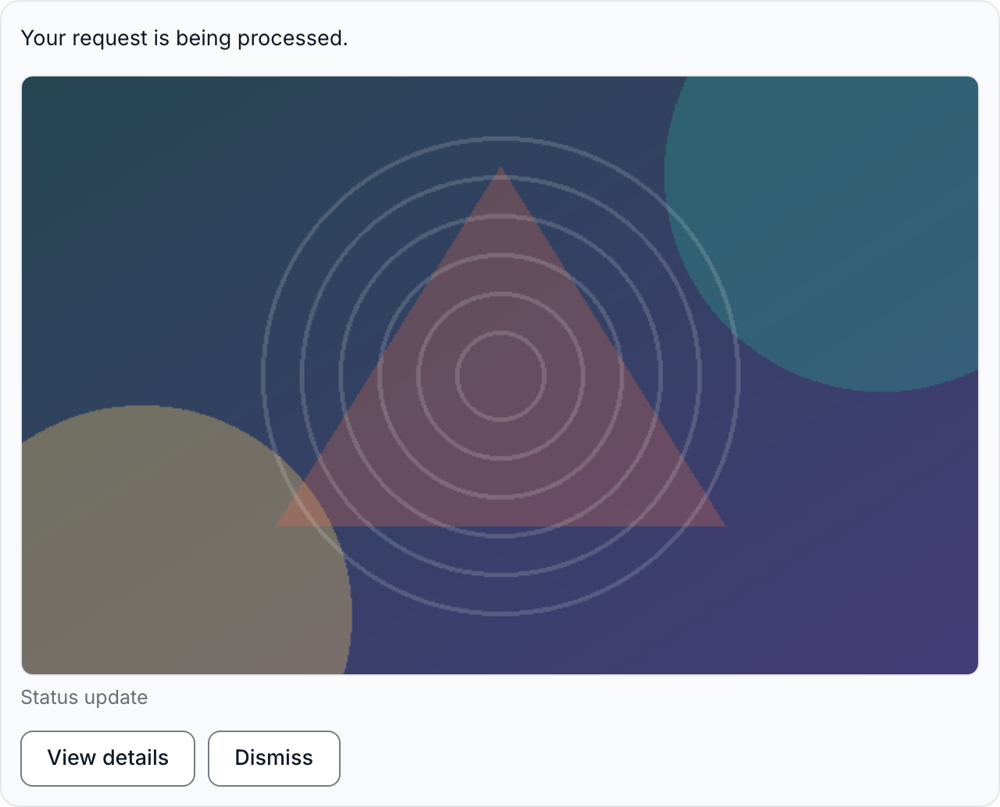
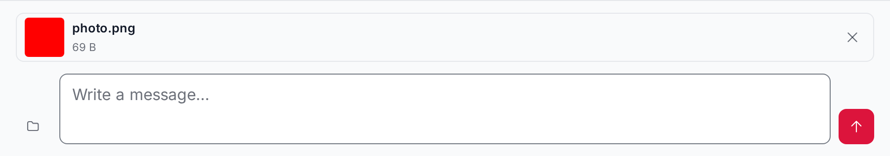

The web channel hosts a standalone chat page for anonymous visitors: it serves
the page, mints a session cookie, and bridges each message through the
conversation bridge — no vendor account, and no account for the visitor. Unlike
the messaging channels it is both the chat surface **and** the transport, and it
holds no vendor secret: the doors are public and authenticate the visitor by the
session cookie alone.

## Enable it

```yaml manifest.yml
channel_modules:
  - tai42_channel_web
```

The only backing store is a plugin-owned Redis holding the session
registrations, the transcripts, and the pending-question records
(`CHANNEL_WEB_REDIS_URL`, falling back per-field to the shared `TAI_DEFAULT_*`
namespace).

## Configuration

The `CHANNEL_WEB_` env group. Defaults suit a typical deployment; the transcript,
stream, and entry-gate caps are the tunables.

| Variable | Default | Effect |
| --- | --- | --- |
| `CHANNEL_WEB_REDIS_URL` | unset | Connection for the session, transcript, and pending-question store. |
| `CHANNEL_WEB_PAGE_TITLE` | `Chat` | The chat page's `<title>`. |
| `CHANNEL_WEB_STORE_OFF_TITLE` | `Chat is unavailable` | The heading of the page served while the deployment runs no chat store. |
| `CHANNEL_WEB_STORE_OFF_TEXT` | `This chat is not switched on. Please contact the site owner.` | The sentence of that page. |
| `CHANNEL_WEB_HTTP_TIMEOUT_SECONDS` | `30` | Timeout for the loopback answer forward to the interactions callback door. |
| `CHANNEL_WEB_SESSION_COOKIE_SECURE` | `true` | `Secure` on the session cookie. Set `false` only where the page is served over plain http (dev/e2e). |
| `CHANNEL_WEB_SESSION_TTL_SECONDS` | `2592000` | Lifetime of the session cookie and the server-side registration, refreshed on every resolving door. |
| `CHANNEL_WEB_SESSION_PENDING_TTL_SECONDS` | `600` | Lifetime a just-minted registration gets before its cookie first returns. |
| `CHANNEL_WEB_TRANSCRIPT_MAX_ENTRIES` | `1000` | `MAXLEN` cap on the browser-replay transcript stream (trimmed exactly). |
| `CHANNEL_WEB_TRANSCRIPT_TTL_SECONDS` | `2592000` | Transcript expiry, refreshed on every append. |
| `CHANNEL_WEB_BACKLOG_BATCH_ENTRIES` | `200` | Transcript entries read per page when a stream replays a backlog. |
| `CHANNEL_WEB_KEEPALIVE_SECONDS` | `15` | Seconds between SSE keepalive frames, and the live-tail block window. |
| `CHANNEL_WEB_BLOCKING_GRACE_SECONDS` | `5` | Grace added to the keepalive window bounding a black-holed Redis read. |
| `CHANNEL_WEB_MAX_STREAMS_PER_VISITOR` | `4` | Concurrent SSE streams admitted for one visitor. |
| `CHANNEL_WEB_MAX_STREAMS_TOTAL` | `500` | Concurrent SSE streams admitted across one process. |
| `CHANNEL_WEB_MAX_BODY_BYTES` | `65536` | Bounded read cap on the POST doors (over-cap is a loud 413). |
| `CHANNEL_WEB_MAX_ANSWER_RESTORES` | `5` | How often one question's record may be re-forwarded after a refused/failed forward. |
| `CHANNEL_WEB_ENTRY_ATTEMPTS_PER_WINDOW` | `10` | Entry-code guesses one client may make against a gated route per window. |
| `CHANNEL_WEB_ENTRY_THROTTLE_WINDOW_SECONDS` | `300` | Length of that throttle window. |

## Create a route and open the page

A web route binds an **identity** — an arbitrary name you choose — to the turn
that answers it.

```bash
tai conversations create web-chat \
  --door channel --target-name chat --execution-key chat-bot \
  --channel web --identity assistant
```

In Studio, pick web as the route's Channel; the Our identity field then shows this hint.

The route's turn runs as the `--execution-key` you bind here; mint a
least-privilege key scoped to just what the route needs, the same way a phone
channel does in [WhatsApp to an agent](/guides/whatsapp-to-agent).

Send visitors to the chat page for that identity:

```
https://<your deployment>/api/channels/web/chat/assistant
```

## Agent-sent cards and lists

A `notify_user` addressed at a web visitor carries richer content than plain text. A
notification's `media` renders as a **media card** — this channel renders the whole media
vocabulary as real UI:

- an **image** inline (an absolute-`https` source; an `http:` or `data:` image is refused
  loudly — the page renders an image only from an https source),
- a **document** as a download card (its `filename` is the label, its caption a secondary
  line, with a download affordance),
- a **video** and an **audio** item as native `<video>`/`<audio>` players,
- a **link** as a safe outbound anchor (a new tab, `rel="noopener"`), rather than folded
  into the body text.

A notification's `options` renders a **tappable option list** (at most 10). Options are typed:
a **reply** chip sends its own text through the message door as an ordinary visitor message —
so it enters the conversation exactly as if the visitor had typed it — and, when the author set
an `id`, that id rides the send as `params.reply_id` so the flow reads which option was chosen;
a reply's optional `description` renders as a secondary line. A **link** option is a
button-styled action that opens its URL in a new tab (`rel="noopener"`) and submits nothing —
visually distinct from a reply chip. The sectioned alternative, `sections`, renders titled
groups of reply rows. An interactive card may also carry a media **header** above the body and a
muted **footer** beneath it. A notification's `location` renders as a **map-pin** element —
readable coordinates, any name/address, and an OpenStreetMap link built from the coordinates
alone (no external map tiles, so the page's CSP fetches nothing cross-origin). `options`,
`sections`, `location`, `header` and `footer` combine with `media` on one card. Templates are
**not** supported — a template is a vendor construct, refused loudly on this channel.



<Warning>
Rendering a remote card image makes the visitor's browser fetch it from the image
host, which reveals the visitor's IP address and request timing to that host (the
page sends no `Referer`). Point card images only at a host the visitor may reveal
themselves to.
</Warning>

## Inbound attachments

A visitor can attach files to a message — an **image**, a **document**, an **audio**
clip, or a **video** — from the composer's attach button, by dragging a file onto the
conversation, or by pasting an image. Each file is uploaded on its own, ahead of the
send: the page shows a preview and a per-file progress indicator, and the visitor can
cancel an upload in flight or remove a ready file before sending. Sending the message
references the uploaded files, which then ride the turn as typed attachments — a
tool target receives them on its payload under the `attachments` key (the first
attachment also echoed on the `media_*` params), and a caption-less send is delivered
as a media-only message.



The upload is a two-step exchange: the file is streamed to the upload door, which
returns a **same-origin** reference the message send binds to the turn. The visitor's
own attachments then render inline in their transcript — an image or player in the
bubble, a document as a download card — and replay for a returning visitor exactly as
any other message.


Which types are accepted and how large a file may be are the deployment's
media-ingestion settings (the `MEDIA_INGEST_` env group): each kind carries its own
byte cap and its own allowlist of accepted types. A file over the cap, of a
disallowed type, or that cannot be stored is refused with an inline message on the
file itself — never a silent drop.

## Ask-less forms

A `notify_user` carrying a `schema` renders an **ask-less form card**: the message is
the form's prompt, the schema draws the same schema-driven widget an `ask` form
question uses — but nothing waits on it. There is no deadline, no timeout, and no
pending interaction; the card simply sits in the conversation, and a submission enters
it as an ordinary participant message: the agent sees a `label: value` text (labels come from
the schema stored server-side; a tool target additionally receives the structured
values on its payload under a `form` key). `schema` requires a non-blank message (the
form needs a prompt), combines with `media` and a `location` on the same card, and excludes
`options`/`sections` and `template` — one message, one interactive surface.

The card settles like an option list, not like a question: submitting shows a local
"Sent" badge and the form **stays fillable** — a visitor may revise and submit again,
and each submission is its own message. The card is submittable for as long as it can
replay in the transcript (the submission token stored server-side ages out with the
transcript itself); after that, a submission is answered with a uniform not-found and
the card says the form is no longer available.

Submitted values are **transport, never validated**: the platform bounds their size
and nesting but does not check them against the schema — treat them exactly as you
treat typed participant text.

### Form words

A form question or an ask-less form card draws the caller's `wording` where it is set,
and the widget's own English where it is not:

- `form.update_failed` replaces the line shown when a form reaction is refused; its
  `{reason}` is the reaction door's own reason, and is empty when the door gave none.
- `form.step_progress` replaces a stepped form's "Step 1 of 2" line; it fills `{step}`
  and `{steps}`.
- For each field under `form.fields`: `required` is the line shown when a required value
  is missing, `invalid` the line for a value of the wrong shape, `true_label` and
  `false_label` the words a yes/no value reads back as on a review page, and
  `add_item`, `remove_item`, `item_label` (with `{n}`, the item's number) and `no_items`
  the words of a list field.
- `answer.rejected` replaces the line shown when an answer is refused and may be given
  again, and `answer.rejected_final` the line shown when the question can no longer be
  answered; each fills `{reason}` with the interactions door's own reason, empty when it
  gave none.

The widget draws no `form.error_line` and no `length_hint`: it shows each field's own
error next to the field.

## Unavailable messages

If a stored transcript entry cannot be rendered — a corrupt record in the replay
stream — the page shows a persistent **"This message is unavailable."** notice in its
place, ordered where the entry belonged, rather than a silent gap in the history. The
server emits a dedicated `chat.unavailable` frame for it (carrying the entry id and its
ordering timestamp) on both the backlog replay and the live tail; the corruption is
logged at `WARNING`. This is distinct from the transient error banner shown when a
frame fails to parse on the page itself.

## Answer and reaction forwarding

A web answer or a form reaction is forwarded server-side to the stored callback URL of
the pending question. Before anything is sent, that stored URL is pinned against the
callback prefix the platform mints under (`{INTERACTIONS_PUBLIC_BASE_URL}/api/interactions/callback/`):
only that exact shape — the same scheme, host and port, no userinfo, query or fragment,
one ticket segment — is accepted. A record outside it, or a deployment with no public
base, is refused: an `ERROR` log names the interaction, the reason and the host (never
the URL, which carries the ticket), the claimed question is not restored, nothing is
sent, and the door answers `500`.

When the interactions door refuses a forwarded answer (`400`), the web door answers
`400` with `code` `answer_refused` while the question may be answered again, or
`answer_retries_spent` once it has been refused as often as it may be and is gone. When
the interactions door refuses a forwarded reaction, the web door answers the same
status. Either body carries `reason`, the interactions door's own error, when that door
gave one; the widget fills it into the caller's sentence as `{reason}`.

For a question asked as sensitive, the `chat.answered` frame records that the question
was answered and carries no answer.

## Link parameters

Query parameters on the chat page URL are **captured with the visitor's session**
and delivered to the turn. A route whose target is a **tool** receives them on
its payload under a `params` key — string values, reachable from `start_expr`
as `.params.<name>`:

```
https://<your deployment>/api/channels/web/chat/assistant?topic=news&ref=abc
```

Bounds are enforced at the door — **at most 16** parameters, each key matching
`^[A-Za-z0-9_-]{1,64}$`, each value at most **512** characters, the whole set at
most **2048** bytes — and a violation is a refused page, never a silent trim: every
web door (the page, messages, forms and answers) **refuses** an over-bound set, because
each answers a waiting visitor. The
names `tai_pair` and `tai_entry` are reserved and stripped before storage. A later
navigation carrying parameters replaces the stored set; starting a new
conversation clears it. Parameter values are never logged, and `params` is
present on the payload only when the entry carried parameters.

When the visitor answers a pending question, the same parameters reach the asker as `params`
beside the answer.

<Warning>
A link parameter is **transport, nothing more** — no signature, no expiry, no
interpretation. When a flow must *trust* a value, it issues its own secret token,
delivers it in the link, and checks it in its own store. jq gating in
`start_expr` runs before the tool does:

```bash
--start-expr 'if .params.key then {example_config_kwargs: {message: .message, token: .params.key}} else error("no key") end'
```
</Warning>

## Entry gate

A web route can be **gated**: the chat page is served only to a navigation
carrying a live entry code on `?tai_entry=<code>`. An ungated route is unchanged
— the gate is opt-in per identity.

Entry codes are operator-minted, multi-use, optionally expiring, revocable, and
**hashed at rest**: only a code's hash is stored, and the raw code exists only in
the mint response and the visitor's link. A missing, unknown, expired, or revoked
code — or a client that has guessed too often — is refused with **one** page,
HTTP `403`, one wording: the gate is no oracle. The gate is checked only where a
session is minted (opening the page or starting a new conversation); an existing
session is admitted without a code.

<Warning>
The gate admits **whoever holds a live code** — never who they are. Forwarding
the link forwards entry. And revocation cuts **new** entries only: a visitor
already admitted keeps a live session until its own TTL lapses. To cut off a live
visitor you end their session, not the code they entered with.
</Warning>

### Operating the gate

In the Studio, a web route's drill-in carries the **Entry gate** panel: the gate
toggle, the live codes, and the mint and revoke dialogs (the plugin's studio-plugin
item `web`, shown where the deployment lists `tai42_channel_web` under
`studio_plugins`). The same lifecycle runs through four authed management doors —
call them with a platform API key.

<Steps>
  <Step title="Enable the gate">
    ```bash
    curl -sS -X PUT "$TAI_BASE_URL/api/channels/web/gates/assistant" \
      -H "X-Api-Key: $ADMIN_KEY" -H 'Content-Type: application/json' \
      -d '{"enabled": true}'
    ```
  </Step>
  <Step title="Mint a code and distribute the link">
    The raw `code` is returned **once**; only its hash (`code_id`) is stored.

    ```bash
    curl -sS -X POST "$TAI_BASE_URL/api/channels/web/gates/assistant/codes" \
      -H "X-Api-Key: $ADMIN_KEY" -H 'Content-Type: application/json' \
      -d '{"label": "spring-cohort", "expires_at": "2026-12-31T00:00:00Z"}'
    ```

    Distribute the chat URL with `?tai_entry=<code>` appended. A code is
    multi-use: everyone holding the link enters.
  </Step>
  <Step title="List codes">
    ```bash
    curl -sS "$TAI_BASE_URL/api/channels/web/gates/assistant" -H "X-Api-Key: $ADMIN_KEY"
    ```

    Codes are listed by hash — a raw code is never re-readable.
  </Step>
  <Step title="Expire or revoke">
    ```bash
    curl -sS -X DELETE "$TAI_BASE_URL/api/channels/web/gates/assistant/codes/<code_id>" \
      -H "X-Api-Key: $ADMIN_KEY"
    ```
  </Step>
</Steps>

## Words

A web route can set its own words, keyed by its identity like the entry gate. Every
member is optional; a member left unset draws the built-in English.

- `page` holds the chat page's refusal pages, each a `heading` (the page title) and a
  `text`: `not_a_navigation` (the chat URL was loaded by something other than a
  top-level navigation), `link_invalid` (the link's parameters break a bound),
  `entry_refused` (a gated route and no live entry code) and `page_unavailable` (the
  page bundle cannot be served).
- `transport` holds the sentences the widget draws when one of its requests is refused:
  `session_ended`, `wrong_site`, `not_listening`, `already_answered`, `busy`,
  `not_switched_on`, `too_long` and `not_sent` (each with `{subject}`), `failed`,
  `attachment_gone`, `attachment_already_sent`, `entry_refused`, and `answer_refused`
  and `answer_retries_spent` (each with `{reason}`, used when the question set no
  `answer.rejected` / `answer.rejected_final`). The `subject_message`,
  `subject_answer`, `subject_form` and `subject_request` members are the words
  `{subject}` is filled with. The attachment tray's upload sentences are fixed and are
  not route words.

A server's error string is never drawn as one of these sentences: it reaches the end
user only as `{reason}`. The page's other words and its `<title>` are not per-route
words; the title is `CHANNEL_WEB_PAGE_TITLE`.

In the Studio, the same drill-in carries the **Words** panel beside the entry gate: one
input per member, a save, and a clear. The same words run through three authed doors:

```bash
# Read (404 when none are set)
curl -sS "$TAI_BASE_URL/api/channels/web/words/assistant" -H "X-Api-Key: $ADMIN_KEY"

# Replace the whole words object
curl -sS -X PUT "$TAI_BASE_URL/api/channels/web/words/assistant" \
  -H "X-Api-Key: $ADMIN_KEY" -H 'Content-Type: application/json' \
  -d '{"page": {"entry_refused": {"heading": "Private chat"}}, "transport": {"busy": "Please wait a moment."}}'

# Clear (404 when none are set)
curl -sS -X DELETE "$TAI_BASE_URL/api/channels/web/words/assistant" -H "X-Api-Key: $ADMIN_KEY"
```

A refused body answers `422` naming the first refused member
(`invalid request body: <member>: <reason>`). A body that sets nothing is refused the
same way: an empty object, an empty `page` or `transport` object, or a refusal page with
neither `heading` nor `text`. To go back to the built-in English, clear the words. The words are part of the platform backup
as the `channel_web_words` section: an import validates the whole section before it
writes anything, then replaces each listed route's words.

## Message ids and addresses

The conversation bridge records every message this channel sends to a visitor. These are the
ids and addresses it records:

- A message POST passes the id it is deduplicated by as the medium message id; the answer door
  passes the id of the `chat.answered` entry it writes.
- `resolve_address` returns the web route identity and the visitor id, from either addressing:
  the composite `"<identity>:<visitor-id>"` recipient, or the route identity beside a bare
  visitor id. A completed send reports the same pair, the one the message door passes for that
  visitor, and the id of the transcript entry it appended.
- The widget has no reply action, so a visitor message never quotes an earlier message: it
  carries no `reply_to`.

## Working-on-it signal

While a turn runs, the chat page shows its own **typing bubble** from the moment the
visitor's message is sent until the reply lands — driven entirely by the page, with
no server-driven frame. Because the page owns the indicator it never lapses
mid-turn, so this channel opts out of the platform's server-side working-on-it
refresh.

## Flood control

Every web door is public, so the app's rate limiter throttles it per caller. The plugin
declares the budgets on its routes: the chat doors (the page, its assets, the stream, the
session rotate, messages, forms, answers and reactions) charge the `channels_web` family at
120 requests a minute and 30 per 10 seconds, and the upload door charges
`channels_web_uploads` at 20 and 5. The families are declared, so they hold whatever mount
base the plugin is installed under. An operator tunes either field by field, for example
`TAI_RATE_LIMIT_FAMILIES__CHANNELS_WEB__LIMIT=240`.

The published API describes each door's real body: the page is `text/html`, an asset is
`application/octet-stream`, and the stream is `text/event-stream`.

## See also

- [Client conversations](/concepts/client-conversations) — the bridge model.
- [Conversation bridge](/reference/conversation-bridge) — the `params` payload key, route CRUD, and
  every setting.
